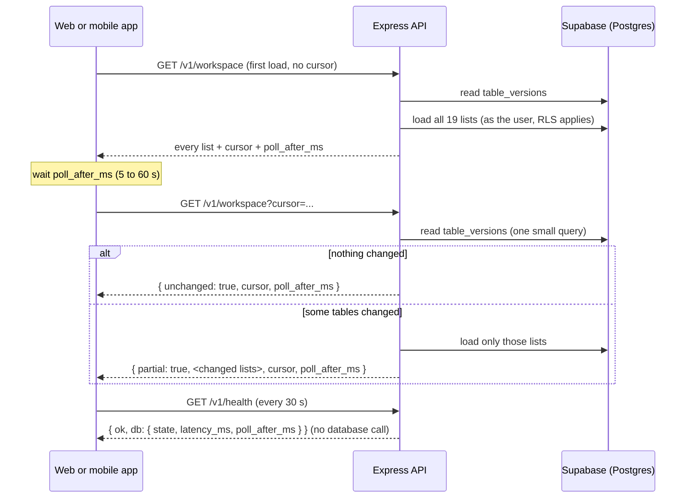

# Live updates: change detection and adaptive polling

*Written 4 Nov 2026, branch `rick-extra-CTIP-security-fix`. Covers the web app, the
mobile app, the API and one database migration.*

The apps keep their data fresh by polling the API. Until now every poll reloaded
**everything**, every 5 seconds, from every open screen. Now:

1. **A poll only fetches what changed.** When nothing changed, the answer is a few
   bytes and costs the database one tiny query.
2. **The poll rate follows the database.** 5 seconds while the database is quick,
   slowing to up to 60 seconds while it is busy, and speeding up again once it recovers.
3. **"API down" means the API is down.** The health check no longer touches the
   database, and the notice needs two missed checks in a row.

The rest of this page explains why, how it works, and what to watch out for when you
add a table or a page.

---

## 1. Why: what was going wrong

People saw "Cannot reach the API server" come and go even though the API was running.
Measured on 4 Nov 2026 against the shared Supabase project:

| Test | Result |
|---|---|
| API with nothing else running | 0.1 to 0.35 s |
| One full load (`GET /v1/workspace`) | 0.7 to 6.4 s, 140 KB |
| Single queries, one at a time | up to 6.9 s, even on `alerts` with 0 rows |
| 4 tabs polling at once | half the loads hit the 30 s timeout; slowest query 17.6 s |
| Old health check (3 s limit) during that | 6 out of 10 failed and showed "API down" |

The database was not slow because of one bad query. It was busy. The main load came
from the apps themselves:

- A signed-in **web tab** reloaded all 19 lists every 5 s (`apps/web/src/useLiveUpdates.js`),
  and the API signed a fresh link for every field photo each time.
- The **mobile app** did the same on 9 screens (`apps/mobile/hooks/usePolling.js`). A bug
  also made it poll again straight after every store update (see [§6](#6-bugs-fixed-on-the-way)).
- On top of that, notifications and an open discussion thread each had their own 30 s poll.

That is about 4 database requests per second for each open screen, all against one
free-tier database shared by the whole team, Render and everyone's local API.

The old health check made it look worse than it was. It called `/public/species`, which
is itself a database query, and gave up after 3 s. One slow answer meant "API down".

---

## 2. The big picture



| Piece | File | Job |
|---|---|---|
| Change counters | `supabase/migrations/20261105000000_table_versions.sql` | One counter per table, raised by a trigger on every write |
| Change-aware load | `services/api/src/staff.js` (`get /workspace`) | Compares counters with the app's cursor and loads only what moved |
| Database load meter | `services/api/src/dbLoad.js` | Times every database call and turns that into a poll delay |
| Health check | `services/api/src/handlers.js` (`get /health`) | Answers "up" without touching the database |
| Merge and pace | `apps/shared/StoreProvider.js` | Keeps the last load, merges partial answers, decides when to poll |
| Pollers | `apps/web/src/useLiveUpdates.js`, `apps/mobile/hooks/usePolling.js` | Wait as long as the store says, then poll again |

---

## 3. Change detection

### 3.1 The counters (database)

The migration adds one table:

```sql
public.table_versions (table_name text primary key, version bigint, changed_at timestamptz)
```

Every table that `GET /v1/workspace` loads has a trigger, `trg_table_version`. After any
insert, update, delete or truncate, it adds 1 to that table's `version`.

- The trigger runs **once per statement**, not per row, so making 500 QR tags in one
  batch is one change.
- It runs inside the same transaction as the write. A poll can never see a new counter
  before the data it describes is committed.
- If the trigger ever fails, it only logs a warning. A counter can never stop a real save.
- Any signed-in user can read the counters. They show how often a table changed, never
  what is in it. Nobody can write to them except the trigger.

Tables watched: `species`, `species_media`, `qr_tags`, `specimens`, `observations`,
`observation_photos`, `observation_reviews`, `observation_comments`, `alerts`,
`alert_notes`, `sensor_nodes`, `notifications`, `audit_logs`, `profiles`, `zones`,
`discussions`, `discussion_audience`, `discussion_posts`.

### 3.2 The cursor (API)

Every workspace answer includes a `cursor`. It is an opaque string that the app sends back
on its next poll as `?cursor=...`. Inside, it holds:

| Field | Meaning |
|---|---|
| `v` | The table counters at the time of that answer |
| `full` | When the last **full** load happened |
| `u`, `r` | The user's id and role it was made for |

On each poll the API:

1. Reads `table_versions` **first**, before any data. A write that happens during the
   load then shows up on the next poll, so nothing is ever missed.
2. Checks whether the cursor can be used. It cannot when:
   - it is missing or cannot be read,
   - it belongs to another user, or the user's role has changed,
   - the last full load was more than 12 hours ago (photo links last 24 hours),
   - or the counters are not there yet (migration not pushed).

   In any of those cases the answer is a normal full load. A bad cursor never causes an error.
3. Works out which tables changed, and which lists to send because of them:

| A change to | Also resends | Why |
|---|---|---|
| `species` | `specimens` | A species' status decides how exact its plants' locations are |
| `specimens` | `species` | Plants are always protected with fresh statuses |
| `discussions` | `discussion_audience`, `discussion_posts` | A deleted thread takes its posts with it |
| `discussion_audience` | `discussions`, `discussion_posts` | Sharing decides who can see a thread |
| `profiles` | `directory` | The people list for sharing and @mentions comes from profiles |

4. Answers in one of three shapes:

| Answer | When | Contains |
|---|---|---|
| `{ partial: false, ...every list }` | First load, or the cursor could not be used | Everything, as before |
| `{ partial: true, <changed lists>, unavailable }` | Some tables changed | Only those lists |
| `{ partial: true, unchanged: true }` | Nothing changed | No lists |

All three also carry `cursor` and `poll_after_ms`.

If one list fails to load, it is named in `unavailable` and its old counter goes back
into the new cursor, so it is asked for again on the next poll.

**Security does not change.** Every list is still read **as the signed-in user**, so
RLS applies exactly as before. Endangered plant locations are still reduced by
`protectSpecimen()` whenever plants are sent, including in a partial answer. That is why
a species change also resends plants.

### 3.3 Merging (apps)

`loadFromApi()` in `apps/shared/StoreProvider.js` keeps the last full set of lists and
its cursor (`lastWorkspace`, one per signed-in user):

- **Unchanged:** only the cursor is updated. The store does not change at all, so nothing
  re-renders and no photo reloads.
- **Partial:** the changed lists replace their old copies, and everything else is kept.
  The merged result then goes through the same shaping code as a full load, so every page
  sees the same data shape as before.
- **Signing out** or a different user clears it, so the next load is full.
- **Visitors** are not affected: `/public/workspace` has no cursor.

Store actions that save something and then call `loadFromApi(true)` get the same
benefit: they now fetch only what they changed.

---

## 4. Adaptive polling

### 4.1 Measuring (API)

All Supabase clients in `services/api/src/supabase.js` use `timedFetch()` from
`services/api/src/dbLoad.js`. For every database (REST) call it records:

- **how long Supabase took to answer**, as a moving average where the newest call
  counts for 10 %, so one slow query does not change the rate on its own,
- **how many calls are waiting** right now.

Storage and Auth calls are not counted; they run on other servers.

### 4.2 The levels

| Database state | Average answer time | Poll every |
|---|---|---|
| free | under 0.4 s | **5 s** (the team's chosen rate) |
| normal | under 1 s | 10 s |
| busy | under 2.5 s | 20 s |
| very busy | under 5 s | 40 s |
| overloaded | 5 s or more | 60 s |

- More than 20 calls waiting counts as at least "busy", and more than 40 as at least
  "very busy", whatever the average says.
- With no database calls for a minute there is nothing to judge, so it goes back to "free".

The API puts the delay in every workspace answer (`poll_after_ms`) and in `/health`
(`db.poll_after_ms`).

### 4.3 Waiting (apps)

`nextPollDelay()` in the store decides the next wait:

1. Start from the API's last `poll_after_ms`.
2. Double it for each missed answer in a row, up to 60 s.
3. Add or take up to 10 % at random, so open tabs do not all ask at the same moment.

- **Web** (`useLiveUpdates.js`): waits `nextPollDelay()`, or at least 15 s after a failed
  load. A hidden tab does not load at all.
- **Mobile** (`usePolling.js`): waits `nextPollDelay()`, but never less than the
  `intervalMs` a screen asks for. Polling pauses while the app is in the background.

**Measured** with 4 simulated officer tabs for 60 s against the live database, with the
counters pushed. One tab marked a notification read after 20 s:

| Poll | Time | Size | Lists sent | Next wait |
|---|---|---|---|---|
| First load (full) | 3.1 to 3.3 s | 140 KB | all 19 | 20 s (database busy) |
| Nothing changed | **0.16 to 0.22 s** | **589 bytes** | none | 20 s |
| After the write | 8.8 to 9.3 s | 14 KB | `notifications` only | 40 s (database very busy) |

A poll when nothing changed is about 15 times faster and 240 times smaller than a full
load. The one partial poll was slow because the shared database was slow at that moment
(its average answer time rose to 2.6 s), and the API answered by slowing polls to 40 s.
`/health` answered in 2 to 9 ms throughout.

---

## 5. Health check

`GET /v1/health` is public and never queries the database:

```json
{ "ok": true, "db": { "state": "free", "latency_ms": 180, "in_flight": 0, "poll_after_ms": 5000 }, "time": "..." }
```

The apps call it every 30 s and when a tab comes back into view (`pingBackend()` in
`apps/shared/api.js`):

| | Before | Now |
|---|---|---|
| Endpoint | `/public/species` (database query) | `/health` (no database) |
| Gives up after | 3 s | 10 s |
| "API down" notice | after 1 miss | after **2 misses in a row** |
| Cleared by | the next health check | **any** answer from the API |

A failed load or save counts as a miss too, and any answer from the API resets the count.

**Measured:** `/health` answered in 2 to 9 ms the whole time, even while workspace loads
took 10 s.

---

## 6. Bugs fixed on the way

- **Mobile polled in a loop.** `usePolling` listed the store's `pollFromBackend` in its
  effect dependencies. That function is new on every store update, so every update
  restarted the effect, and the effect polls immediately on start. A poll that changed
  data caused another poll at once. The functions now live in a ref, and the timer only
  restarts when the screen, the sign-in or the app's foreground state changes.
- **Duplicate polls removed.** The separate 30 s notifications poll and the 30 s
  open-discussion poll are gone. Both now arrive with the regular change-only updates.
  An open thread still reloads once when you open it.

---

## 7. When you add something

**A new table the apps load:**

1. Add it to `WORKSPACE` in `services/api/src/staff.js`.
2. Add a migration that puts the `trg_table_version` trigger on it. Copy the loop in
   `20261105000000_table_versions.sql`, and insert its row into `table_versions`.
   **Without the trigger, changes to that table will not show up** until the next full
   load (sign-in, page reload, or after 12 hours).
3. If what it shows depends on another table, add both to `ALSO_RELOAD` in `staff.js`.
4. Map it in `loadFromApi()` (`apps/shared/StoreProvider.js`), with a `collectionMatches`
   check like the others.

**A list that is not a table** (like `directory`, which comes from a function): add it to
`SOURCE` in `staff.js` with the table it is built from.

**A page that needs fresher data than everything else:** don't add a `setInterval` that
reloads the workspace. Load just what that page shows (as `refreshDiscussion()` does),
and only when it opens.

---

## 8. Known limits

- **Counters are per table, not per user.** A new notification for anyone makes every
  signed-in app reload its own notifications. The list is small, so this was kept simple.
  The same goes for `audit_logs`, which grows with every audited write; admins reload it
  whenever anything audited changes.
- **A change in who can see what, without a write to a watched table,** is only picked up
  by the next full load. A user's role change is covered: their token, and therefore the
  cursor, changes when it refreshes.
- **A soft-deleted observation's photos** stay in the store until the photos change or the
  next full load. Pages only show photos of observations that are loaded, so they do not
  appear.
- **The load meter is per API instance.** Each laptop's local API judges only its own
  calls. Render runs one instance, so the live site has one meter.
- **Older API (Render before the redeploy):** the apps still work. `/health` answers 404,
  which counts as up; the cursor is ignored, so every poll is a full load at 5 s.
- **Before the migration is pushed**, every poll is a full load. The adaptive delay and
  the new health check still work.

---

## 9. Tests

| File | What it checks |
|---|---|
| `services/api/test/field-and-staff.test.js` (8 new) | The first load is full with a cursor; "unchanged" when nothing moved; only the changed list is sent; a species change resends plants with endangered spots still reduced; someone else's cursor and a broken cursor get a full load; no counters means full loads; `/health` makes no database call |
| `services/api/test/dbLoad.test.js` (6) | No data means 5 s; fast stays fast; slow slows down up to 60 s; recovers once quick again; one slow query does not slow everyone; old measurements are ignored |

Run with `npm run api:test` from the repo root.
